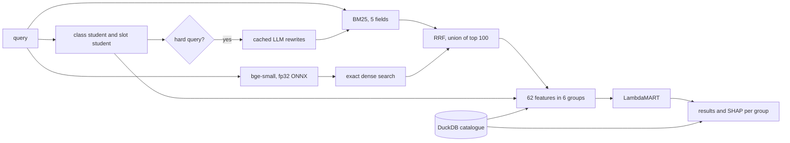

# ShelfRank

Query understanding and learning-to-rank for home-goods product search, evaluated on [WANDS](https://github.com/wayfair/WANDS), Wayfair's
public relevance benchmark (ECIR 2022): 42,994 products, 480 queries and 233,448 human judgments.

<!-- begin:pitch -->
On WANDS, a LambdaMART ranker raised nDCG@10 from 0.782 (hybrid RRF) to 0.820, a difference of +0.038 [+0.027, +0.048] on 384 held-out queries, and the gain holds under condensed evaluation (+0.020 [+0.010, +0.030]). Tuned BM25 scores 0.746. Feature groups whose removal hurts: G1, G2.

Secondary comparison, LTR against tuned BM25: +0.074 [+0.057, +0.091] standard, +0.060 [+0.043, +0.077] condensed, Holm p 0.0004: a gain that holds under both evaluations.
<!-- end:pitch -->

Settings were frozen and tagged (`preregistered-v1`) before any of the 384 evaluation queries was read, and the evaluation ran once. A gain is
claimed only when it holds with unjudged products counted as irrelevant **and** with them removed, and after Holm correction. Null and negative
results are in the same tables.

## Key results

<!-- begin:key_results -->
| System | nDCG@10 | Condensed nDCG@10 | Judged@10 | Exact@10 / ceiling | Exact@10 | MRR Exact | Recall@100 |
| --- | --- | --- | --- | --- | --- | --- | --- |
| BM25, title only | 0.695 [0.664, 0.726] | 0.763 [0.736, 0.790] | 0.887 | 0.548 | 0.408 | 0.668 | 0.378 |
| BM25 multi-field, tuned | 0.746 [0.717, 0.774] | 0.804 [0.779, 0.828] | 0.904 | 0.589 | 0.447 | 0.679 | 0.400 |
| Dense, bge-small off the shelf | 0.739 [0.710, 0.766] | 0.843 [0.822, 0.862] | 0.839 | 0.612 | 0.477 | 0.724 | 0.358 |
| Dense, bge-small fine-tuned on ESCI | 0.759 [0.732, 0.786] | 0.857 [0.838, 0.875] | 0.854 | 0.603 | 0.484 | 0.728 | 0.376 |
| Hybrid RRF (BM25 + off-the-shelf) | 0.782 [0.755, 0.808] | 0.844 [0.823, 0.864] | 0.910 | 0.629 | 0.488 | 0.722 | 0.409 |
| Hybrid RRF (BM25 + fine-tuned) | 0.794 [0.768, 0.819] | 0.853 [0.834, 0.871] | 0.911 | 0.630 | 0.494 | 0.735 | 0.414 |
| **LTR, full (LambdaMART)** | 0.820 [0.795, 0.843] | 0.864 [0.843, 0.883] | 0.930 | 0.681 | 0.530 | 0.781 | 0.423 |
| *Perfect ranker (ceiling)* | 0.997 | 0.997 | 0.986 | 1.000 | 0.764 | 1.000 | 0.575 |
| *n queries* | 384 | 384 | 384 | 305 | 305 | 305 | 383 |

| Comparison | nDCG@10 | Condensed nDCG@10 | Holm p | Verdict |
| --- | --- | --- | --- | --- |
| LTR, full (LambdaMART) vs Hybrid RRF (BM25 + off-the-shelf) | +0.038 [+0.027, +0.048] | +0.020 [+0.010, +0.030] | 0.0004 | **gain** |
| LTR, full (LambdaMART) vs BM25 multi-field, tuned | +0.074 [+0.057, +0.091] | +0.060 [+0.043, +0.077] | 0.0004 | **gain** |

Primary queries are the 384 of folds 1 to 4. Settings were frozen before any of them was read. Read with it:

- **Quote the condensed number.** The standard gain is +0.038 and the gain that ignores unjudged products
  +0.020. The difference is what unjudged handling can explain.
- **The dev fold does not show it:** +0.009 [-0.008, +0.028] standard and -0.015 [-0.044, +0.008] condensed there. Every other fold does. The result was
  checked for leaks before it was believed ([docs/RESULTS.md](docs/RESULTS.md), section 2).
- **Against a stronger baseline** that was not pre-registered, hybrid RRF with the fine-tuned encoder, LTR is +0.025 [+0.014, +0.036] standard and
  +0.011 [+0.000, +0.021] condensed.
<!-- end:key_results -->

## Why WANDS

It is a home-goods catalogue with real queries and human labels on three levels, from the company whose search problem this is. It is also small,
and its judgment pool was partly chosen with Wayfair's own query classifier. Both facts shape the protocol: cross-validation by query, a
frozen dev fold, and a pool rule for every claim ([docs/PROTOCOL.md](docs/PROTOCOL.md), [docs/data_audit.md](docs/data_audit.md)).

## Architecture



Offline: an LLM teacher (Gemini) labels 2,000 ESCI queries. The students are distilled from those labels and from product names, so serving needs
no LLM. ESCI also fine-tunes the encoder. No WANDS query is in any training set or prompt.

## Evaluation protocol

| | |
| --- | --- |
| Split | 5 folds by query, near-duplicates kept together. Fold 0 for all development, folds 1 to 4 (384 queries) for results |
| Pre-registration | `configs/frozen.yaml`, tag `preregistered-v1`, one out-of-fold run. Code refuses other folds before that file exists |
| Metrics | nDCG@10 (Exact 2, Partial 1), condensed nDCG@10, judged@10, Exact@10 as a share of its ceiling, Recall@100, MRR. Checked against ranx |
| Statistics | Paired bootstrap over queries (10,000), Holm within declared families |
| Pool rule | A gain needs both standard and condensed intervals above 0 |
| Wording | The text for every possible outcome was written before the run ([docs/README_FRAMING.md](docs/README_FRAMING.md)) |

## Ranking

<!-- begin:ablation -->
| Configuration | nDCG@10 | Condensed | Difference to full | Difference, condensed | Holm p | Verdict |
| --- | --- | --- | --- | --- | --- | --- |
| full model | 0.820 [0.795, 0.843] | 0.864 [0.843, 0.883] |  |  |  |  |
| minus G1 lexical match | 0.798 | 0.850 | -0.021 [-0.030, -0.013] | -0.013 [-0.020, -0.007] | 0.0020 | loss |
| minus G2 semantic and fusion | 0.802 | 0.849 | -0.018 [-0.029, -0.007] | -0.014 [-0.022, -0.007] | 0.0112 | loss |
| minus G3 query class | 0.813 | 0.858 | -0.007 [-0.013, -0.001] | -0.006 [-0.011, -0.001] | 0.1230 | loss |
| minus G4 attribute match | 0.816 | 0.861 | -0.004 [-0.008, -0.000] | -0.003 [-0.005, -0.000] | 0.1230 | loss |
| minus G5 product priors | 0.816 | 0.861 | -0.004 [-0.009, +0.000] | -0.003 [-0.006, +0.000] | 0.2346 | no clear difference |
| minus G6 text shape | 0.813 | 0.861 | -0.007 [-0.012, -0.002] | -0.003 [-0.006, -0.001] | 0.0996 | loss |
| G1 only (LTR machinery without new features) | 0.796 | 0.847 | -0.023 [-0.034, -0.012] | -0.017 [-0.025, -0.009] | 0.0020 | loss |
| pointwise regression, same features | 0.814 | 0.858 | -0.005 [-0.013, +0.003] | -0.005 [-0.012, +0.000] | 0.4468 | no clear difference |
| other treatment of unjudged training rows | 0.753 | 0.876 | -0.066 [-0.083, -0.050] | +0.012 [+0.004, +0.020] | 0.0196 | direction depends on unjudged handling |
| fine-tuned encoder in candidates and G2 | 0.824 | 0.864 | +0.004 [-0.004, +0.012] | -0.000 [-0.009, +0.007] | 0.9851 | no clear difference |

Groups whose removal is a loss after Holm: **G1, G2**. The attribute features (G4) are not among them. G3, G4 and G6 have unadjusted
intervals below 0 that do not survive correction.
<!-- end:ablation -->

By department, SHAP and all comparisons: [docs/final_results.md](docs/final_results.md). Business terms, failure analysis of the 20 worst queries and the
A/B plan: [docs/RESULTS.md](docs/RESULTS.md).

## Query understanding

<!-- begin:understanding -->
**Product class**, as agreement with Wayfair's assigned query class. The student is character n-grams with a linear model, trained on
product names and 1,599 teacher-labelled ESCI queries, and takes 1.3 ms per query on CPU.

| Split | n | Student accuracy | Top-3 | Department | Macro-F1 | Gemini zero-shot accuracy |
| --- | --- | --- | --- | --- | --- | --- |
| dev | 96 | 0.635 [0.542, 0.729] | 0.896 | 0.708 | n/a | 0.688 [0.594, 0.781] |
| primary | 384 | 0.669 [0.622, 0.716] | 0.875 | 0.760 | 0.754 (21 classes) | 0.750 [0.706, 0.792] |
| all | 480 | 0.662 [0.621, 0.704] | 0.879 | 0.750 | 0.717 (29 classes) | 0.738 [0.698, 0.775] |

**Attribute slots**, exact-span F1 over color, material_finish, style and room, **vs LLM silver labels; human verification pending**.

| Split | n | With a slot | Student (word tagger) | Lexicon matcher |
| --- | --- | --- | --- | --- |
| dev | 96 | 29 | 0.754 [0.607, 0.877] | 0.676 [0.507, 0.830] |
| primary | 384 | 150 | 0.827 [0.764, 0.882] | 0.730 [0.667, 0.787] |
| all | 480 | 179 | 0.814 [0.757, 0.864] | 0.720 [0.661, 0.776] |

Details: [docs/class_dev.md](docs/class_dev.md), [docs/slots_dev.md](docs/slots_dev.md).
<!-- end:understanding -->

## Retrieval and fine-tuning

<!-- begin:retrieval -->
| Comparison | nDCG@10 | Condensed nDCG@10 | Holm p | Verdict |
| --- | --- | --- | --- | --- |
| Dense, bge-small off the shelf vs BM25 multi-field, tuned | -0.007 [-0.030, +0.016] | +0.038 [+0.018, +0.059] | 0.5489 | **direction depends on unjudged handling** |
| Hybrid RRF (BM25 + off-the-shelf) vs BM25 multi-field, tuned | +0.036 [+0.021, +0.051] | +0.040 [+0.026, +0.054] | 0.0010 | **gain** |
| Dense, bge-small fine-tuned on ESCI vs Dense, bge-small off the shelf | +0.021 [+0.007, +0.035] | +0.014 [+0.003, +0.025] | 0.0366 | **gain** |
| Hybrid RRF (BM25 + fine-tuned) vs Hybrid RRF (BM25 + off-the-shelf) | +0.012 [+0.004, +0.022] | +0.009 [+0.002, +0.017] | 0.0366 | **gain** |
| BM25 multi-field, tuned vs BM25, title only | +0.051 [+0.036, +0.066] | +0.041 [+0.027, +0.056] | 0.0010 | **gain** |

On dev the fine-tuned encoder showed "no clear difference" as a dense retriever, so by a rule written before measuring, the ranker kept the off-the-shelf
encoder. On the primary queries it is better. int8 lost 0.010 nDCG@10 on dev, more than the tolerance of 0.005, so the demo uses fp32 ONNX
([docs/dense_dev.md](docs/dense_dev.md), [docs/phase3_checks.md](docs/phase3_checks.md)).
<!-- end:retrieval -->

## Query rewriting

<!-- begin:rewriting -->
Gemini rewrites a query when `dense_top` looks hard. The trigger was chosen on dev and fires on 171 of 384 primary
queries.

- All queries, LTR with triggered rewriting against LTR: -0.009 [-0.017, -0.001] standard, -0.006 [-0.014, +0.001] condensed, Holm p 0.2536:
  **direction depends on unjudged handling**.
- Triggered queries only: -0.019 [-0.039, -0.002] standard, -0.012 [-0.030, +0.003] condensed. 63 got worse, 38 better, 70 stayed the same.
- Rs 15.8 per 1,000 rewritten queries. API time p50 870 ms, p95 1176 ms.

Harm analysis and bounds: [docs/rewriting.md](docs/rewriting.md).
<!-- end:rewriting -->

## Search suggestions

<!-- begin:suggestions -->
| Typed | n | Most frequent words, MRR | N-gram over the query trie, MRR | Difference |
| --- | --- | --- | --- | --- |
| 1 word | 390 | 0.048 | 0.127 | +0.079 [+0.054, +0.105] |
| 2 words | 329 | 0.107 | 0.222 | +0.115 [+0.076, +0.155] |
| 3 words | 199 | 0.087 | 0.220 | +0.133 [+0.083, +0.184] |

There are no query counts in the data, so nothing here is popularity. A class prior was tried and its cross-validated weight is 0
([docs/suggest.md](docs/suggest.md)).
<!-- end:suggestions -->

## More like this

<!-- begin:similar -->
4,172 seed products from 263 primary queries. Products labelled Exact for the same query are substitutes of each other.

| System | nDCG@10 | Condensed | Recall@10 | MRR |
| --- | --- | --- | --- | --- |
| BM25 on product text | 0.481 | 0.575 | 0.162 | 0.613 |
| Dense, off the shelf | 0.501 | 0.594 | 0.167 | 0.654 |
| Dense, fine-tuned on ESCI | 0.523 | 0.605 | 0.175 | 0.662 |
| Hybrid RRF | 0.522 | 0.610 | 0.179 | 0.656 |
| RRF re-ranked | 0.521 | 0.608 | 0.177 | 0.654 |

| Comparison | nDCG@10 | Condensed nDCG@10 | Holm p | Verdict |
| --- | --- | --- | --- | --- |
| RRF re-ranked vs Hybrid RRF | -0.001 [-0.004, +0.001] | -0.002 [-0.005, +0.000] | 0.3960 | no clear difference |
| Hybrid RRF vs BM25 on product text | +0.041 [+0.031, +0.052] | +0.036 [+0.025, +0.047] | 0.0006 | gain |
| Dense, fine-tuned on ESCI vs Dense, off the shelf | +0.022 [+0.013, +0.031] | +0.011 [+0.003, +0.020] | 0.0232 | gain |

This measures substitutability, not engagement or complementarity ([docs/similar.md](docs/similar.md)).
<!-- end:similar -->

## Production slice

A Streamlit demo (`app.py`) and a FastAPI service read the same engine, which uses the same feature code as the evaluation. No torch, no
scikit-learn.

```powershell
docker build -t shelfrank .
docker run --rm -p 8000:8000 shelfrank
curl.exe "http://127.0.0.1:8000/search?q=grey%20velvet%20sofa&k=3"
```

`GET /search`, `GET /similar/{product_id}`, `GET /health`. A WANDS query is ranked by the models of its own fold, which never trained on it.

<!-- begin:latency -->
| Stage (ms) | LTR p50 | LTR p95 | Hybrid RRF p50 | Hybrid RRF p95 |
| --- | --- | --- | --- | --- |
| Dense encode (fp32 ONNX) | 18.2 | 22.8 | 10.1 | 13.5 |
| BM25 and dense search, fusion | 19.2 | 22.1 | 11.6 | 14.0 |
| Query understanding | 4.7 | 6.3 | 2.3 | 3.4 |
| Feature build (all candidates) | 347.2 | 444.3 |  |  |
| LTR score | 9.5 | 12.9 |  |  |
| Rank list |  |  | 9.6 | 12.5 |
| Fetch products (DuckDB) | 39.1 | 46.2 | 18.0 | 24.2 |
| **Total** | 435.0 | 535.5 | 52.2 | 60.8 |

3 passes over 96 dev queries, one at a time, on the development laptop (Intel64 Family 6 Model 142 Stepping 12, no GPU). Start-up takes 7.2 s once the
model is downloaded, the first search 2.2 s, and peak memory is 806 MB. The API and demo return the evaluated LTR
top 10 exactly for 95.4% of the 480 WANDS queries (99.8% of the products). The rest differ by rounding of half-precision
product vectors.
<!-- end:latency -->

## How this maps to Wayfair search

<!-- begin:mapping -->
| Area | What is here | Results |
| --- | --- | --- |
| Query understanding | Class and slot students distilled from an LLM teacher | [link](#query-understanding) |
| Query rewriting | Serving-time trigger, harm analysis, cost per 1,000 queries | [link](#query-rewriting) |
| Search suggestions | Prefix completion, evaluated without popularity data | [link](#search-suggestions) |
| Ranking | LambdaMART over six feature groups, pre-registered ablation | [link](#ranking) |
| Retrieval | BM25, dense, contrastive fine-tuning on ESCI, fusion | [link](#retrieval-and-fine-tuning) |
| Content recommendations | Item-to-item substitutes from human labels | [link](#more-like-this) |
| Evaluation with business metrics | Exact@10 by department, pool bias, leak checks | [link](docs/RESULTS.md#4-in-business-terms) |
| Experiment design | A/B plan with guardrails and roll-back rules | [link](docs/RESULTS.md#7-plan-for-an-ab-test) |
| Production | FastAPI service, Docker image, latency budget | [link](#production-slice) |
| Personalization | Design note: why it cannot be evaluated here, and what to build | [link](docs/PERSONALIZATION.md) |
<!-- end:mapping -->

## Findings from development

<!-- begin:findings -->
All on the 96 dev queries, exploratory and uncorrected.

- **The order of dense and BM25 depends on unjudged handling.** Against tuned BM25, off-the-shelf bge-small
  is -0.036 [-0.075, +0.005] on standard nDCG@10 and
  +0.033 [-0.004, +0.075] on condensed nDCG@10. Its
  top-10 results outside the query's class are 65.6% judged, against
  92.7% inside it, which lowers its standard score.
- **Tuning is optimistic, which is why results are held out.** Tuned field weights score
  0.759 on the queries they were tuned on and
  0.742 on queries they were not. The held-out gain over title-only BM25 is
  +0.015 [-0.015, +0.044].
- **The product class field has weight 0** once the category path has weight
  0.5, and 3 of 4 held-out searches agree. The likely
  reason is that the path carries the same signal.
<!-- end:findings -->

## Limitations

<!-- begin:limitations -->
- **The judgment pool favours class match.** Wayfair's own query classifier helped choose
  which products were judged. A product in the query's class is judged
  55.4% of the time, against
  1.1% for a random pair, so class features can gain by retrieving judged
  products. Condensed nDCG@10 and judged@10 are reported beside every such claim.
- **Some metrics have low ceilings.** A perfect ranker reaches Exact@10 of
  0.764 on the 305 primary queries that have an Exact product, and
  Recall@100 of 0.575 on 383.
- **The benchmark is small.** It has 480 queries, and the headline uses
  384.
- **Patterns have no slot.** Floral, striped, geometric, plaid and solid are out of scope in this version. The
  catalogue keeps them under their own keys and lists none of them as a style.
- **Finishes share a slot with materials.** "Brushed nickel" and "oak" are both material_finish, because too few
  queries name a finish to train a separate slot. Matching looks a value up in colour, finish and material
  keys together, so the result does not depend on the slot.
- **The taxonomy has gaps.** No blanket class reaches the 30-product cut, so a query for a blanket is labelled
  "Bedding Sets".
- **`query_class` is itself a model prediction**, so classifier accuracy means agreement with Wayfair's
  classifier.
<!-- end:limitations -->
- **Slot labels are an LLM's.** Every slot F1 is vs LLM silver labels; human verification pending. A first human labelling attempt was discarded and a
  planned round was dropped for time, before the freeze ([docs/PROTOCOL.md](docs/PROTOCOL.md), section 6).
- **Pretraining contamination is possible.** bge-small and Gemini may have seen WANDS on the web. Nothing here can rule it out.
- **Offline is not online.** nDCG is agreement with annotators. It is no evidence of clicks, carts or revenue.
- **Some choices used dev data.** BM25 weights, the training option and the student selection were chosen on fold 0, so dev numbers are optimistic.
- **The fine-tuning run was not fully logged.** Wall time, resumes and per-query scores of that run are missing and are not estimated.

## What I would build next with behavioural data

Session-aware re-ranking, and why it cannot be evaluated honestly on WANDS: [docs/PERSONALIZATION.md](docs/PERSONALIZATION.md).

## Reproduce

```powershell
uv sync --extra dev --extra bench --extra app --extra api
uv run python scripts/reproduce.py --offline --fixture   # no download: cached LLM answers, tables, fixture search
uv run python scripts/get_wands.py                       # about 96 MB, verified by SHA-256
uv run python scripts/encode_products.py bge_small       # about 35 min on CPU, resumable
uv run python scripts/reproduce.py --offline             # every step the local files allow, zero API calls
uv run python -m streamlit run app.py
uv run pytest
```

The final ranker run itself is `scripts/run_final.py` at the tag `preregistered-v1` (about 100 minutes on CPU). The encoder is fine-tuned in Colab
([docs/COLAB.md](docs/COLAB.md)).

<!-- begin:spend -->
LLM spend, whole project: **Rs 46.30** of a Rs 500 limit in code (labelling Rs 38.70, rewriting Rs 7.59, smoke Rs 0.01). Costs include a 24% margin for tax and card fees. Every response is cached and committed, so results rebuild at no cost.
<!-- end:spend -->

## Project layout

| Path | Contents |
| --- | --- |
| `shelfrank/data`, `text`, `bm25`, `dense` | loading, normalisation, retrieval, fine-tuning |
| `shelfrank/qu`, `llm` | students, teacher prompts, budgeted and cached LLM client |
| `shelfrank/features`, `ltr` | six feature groups, LambdaMART, gates, ablation |
| `shelfrank/rewrite`, `suggest`, `similar` | rewriting, suggestions, substitutes |
| `shelfrank/eval`, `stats` | metrics, harness, pool rule, bootstrap, Holm |
| `shelfrank/app_support`, `app.py`, `app_data` | engine, API, demo and its data |
| `scripts`, `configs`, `results`, `docs`, `tests` | entry points, frozen settings, committed results, generated pages, tests |

WANDS is MIT licensed and ESCI Apache-2.0 ([docs/DATA.md](docs/DATA.md)). This project is not affiliated with Wayfair or Amazon.

Individual project by Rohit Kumar, M.Tech CSE, IIIT Delhi. [GitHub](https://github.com/iamrohitkumaryadav9)
